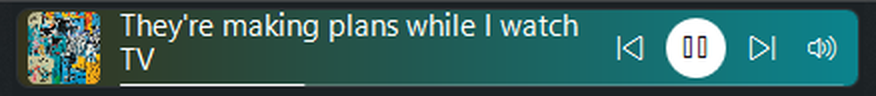
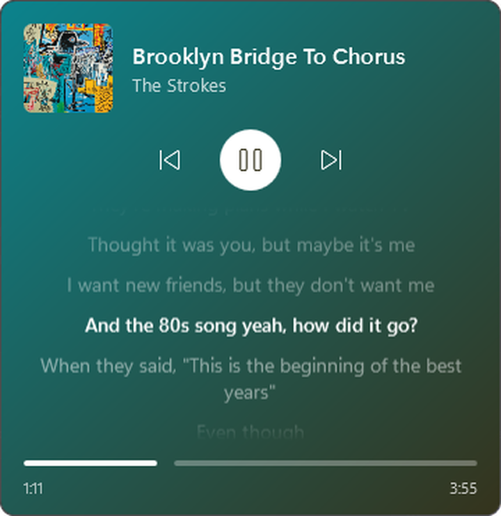
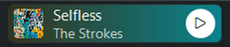
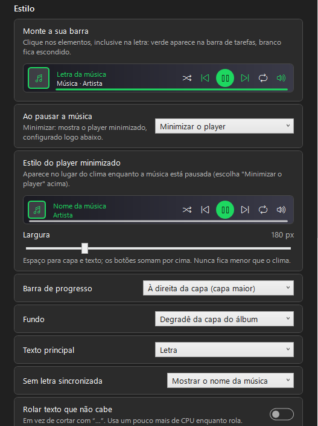

<p align="center">
  
</p>

<h1 align="center">Taskitify</h1>

<p align="center"><b>English</b> · <a href="README.pt-BR.md">Português</a></p>

<p align="center">
  <b>Spotify lyrics on the Windows 11 taskbar, right where the weather widget sits.</b><br />
  Synced line by line, colored by the album art, with a mini player one click away.
</p>

<p align="center">
  <a href="https://github.com/CarlosVinniFernandes/Taskitify/releases/latest"><b>⬇ Download</b></a> ·
  <a href="#how-to-use">How to use</a> ·
  <a href="#customization">Customization</a> ·
  <a href="docs/COMO-FUNCIONA.md">How it works</a>
</p>

<p align="center">
  
</p>

---

## What it is

Taskitify shows the current line of the song playing on Spotify **right on the taskbar**, in the space used by the Windows 11 weather widget.

- **Playing:** the lyric replaces the weather and follows the song line by line.
- **Paused, stopped or Spotify closed:** the weather comes back instantly. If you prefer, Taskitify can shrink to a minimized player instead of disappearing.
- **Click the lyric:** a mini player opens with the album art, controls, progress and the scrolling lyrics.

No Spicetify, Spotify login or Premium is needed for the default LRCLIB source. Taskitify reads what is playing through Windows' own media sessions. An optional, experimental Spotify connection can also fetch lyrics from Spotify itself.

## Features

| | |
|---|---|
| 🎤 **Synced lyrics** | The current line on the taskbar, in one or two lines, with a smooth transition. Keeps up with pauses, skips and seeks. |
| 🎨 **Album colors** | The background is a gradient taken from the album art, like Spotify's, and it fades to the new colors on every song. |
| 🎛️ **Taskbar player** | Previous, play/pause, next, shuffle, repeat, volume and a progress bar. You choose which ones appear. |
| 🪟 **Mini player** | One click on the lyric shows the album art, controls and the full scrolling lyrics with the current line highlighted. Click a line to jump to it. Its elements and width are set in Settings, like the bar's. |
| ⏸️ **Minimized player** | When paused, Taskitify can shrink to the size of the weather widget (art, title and a play button) instead of hiding. |
| 🧩 **Customize your bar** | A replica of the player in the settings: click each element to turn it on (green) or off (white). |
| 🖥️ **Made for Windows 11** | Hides with the taskbar in fullscreen, never steals focus, stays out of Alt+Tab and handles DPI scaling and dark mode. |
| 🌍 **6 languages** | English, Português, Español, Français, Deutsch and Italiano. Switch in Settings → General → Language. |
| 🪶 **Lightweight** | About 60 MB of RAM and under 1% of one CPU core while playing; idle when paused. Never runs as administrator. |

<p align="center">
  
  &nbsp;&nbsp;
  
</p>
<p align="center"><sub>Mini player (click the lyric) · minimized player while the song is paused</sub></p>

## Installation

1. Download `Taskitify-win-x64.zip` from the [**Releases**](https://github.com/CarlosVinniFernandes/Taskitify/releases/latest) page.
2. Extract `Taskitify.exe` to a permanent folder, for example `Documents\Taskitify`.
3. Open `Taskitify.exe` and play a song on Spotify.

> **"Windows protected your PC"?** The executable is not signed with a paid certificate, so SmartScreen warns the first time. Click **More info** and then **Run anyway**. The code is open: you can review everything here or [build it yourself](#building).

**Requirements:** 64-bit Windows 11 (or Windows 10 version 1809 or later) and **Spotify Desktop** installed. No .NET installation needed.

## How to use

| Action | What happens |
|---|---|
| Open the app for the first time | A screen explains the two ways to get lyrics (LRCLIB only, or Spotify + LRCLIB) and makes clear that the Spotify connection changes nothing in your account |
| Play a song on Spotify | The lyric replaces the weather widget |
| Click the lyric | Opens or closes the mini player |
| `Esc` or click outside | Closes the mini player |
| Click a line in the mini player | Jumps the song to that line |
| Mouse wheel over the mini player's lyrics | Scrolls the lyrics freely; **Sync with the song** goes back to the current line |
| Mouse wheel on the volume button | Changes Spotify's volume (click to mute) |
| Right-click the lyric | Fetch lyrics again (from Spotify or LRCLIB), show song and artist, calibrate position, settings, exit |
| Tray icon | Settings, mini player and exit |

To start with Windows: **Settings → General → Start with Windows**.

## Customization

Under **Settings → Style**, Taskitify shows a replica of the player. Click each element, including the lyric: **green** shows on the taskbar, **white** stays hidden. The minimized player (while the song is paused) has its own builder and its own width.

<p align="center">
  
</p>

You can also choose:

- **Background:** the album-art gradient or the same color as the taskbar.
- **Main text:** the lyric or the song title.
- **Progress bar:** below everything, or to the right of the album art (with a larger cover).
- **When paused:** hide (the weather comes back) or minimize the player.
- **No synced lyrics:** show the song title or hide.
- **Font size, width, animations** and scrolling for text that does not fit.
- **Timing adjustment (offset)**, if the lyrics run early or late.
- **Position calibration**, in case Windows places the weather widget somewhere else.

## Privacy

### Optional Spotify lyrics

In **Settings → Advanced → Spotify lyrics (experimental) → Connect Spotify**, sign in directly on Spotify in the Taskitify window. Use email login if an external sign-in option does not open. Keep playback in Spotify Desktop; the web window is only for this connection and can be closed after signing in. This requires Microsoft Edge WebView2 Runtime.

For uncached songs, Spotify is asked first. LRCLIB is only asked when Spotify has no synced lyrics for the song or cannot be reached, which also keeps LRCLIB requests to a minimum. Local `.lrc` files still take precedence, and cached lyrics are reused. Use **Fetch lyrics again** → **Fetch lyrics from Spotify** or **from LRCLIB** to look a cached song up again in the source you pick (when the other version is better timed, for example). What that source finds becomes the saved lyrics; if it has none, the saved ones stay. Plain lyrics are used only if neither source returns synced lyrics, Spotify's first.

The hidden Spotify web window only opens to get an access token (about once an hour) and for the first search after Taskitify starts; it closes 30 seconds later. Song changes look lyrics up directly with Spotify, in about a second.

This uses Spotify's unofficial web-player lyrics service. Login does not guarantee access: Spotify can refuse lyrics, require renewed login, or change its service. The connection status distinguishes a captured session from a successful lyrics response. LRCLIB remains available when Spotify fails. Automated tests use simulated Spotify responses; account-specific access must be checked after signing in.

### Data

- No Taskitify account or telemetry. Spotify login is optional.
- LRCLIB receives the song title, artist, album and duration. When connected, Spotify also receives searches and lyrics requests; its web player makes its own network requests.
- Spotify login uses a separate WebView2 profile in `%LocalAppData%\Taskitify\spotify-web-session`; it does not read the Spotify Desktop or browser profiles. Access tokens stay in memory and are not written to settings or logs. **Disconnect** disables this source and clears the WebView2 browsing data. Lyrics may remain in the normal lyrics cache, which can be cleared separately.
- Settings and the lyrics cache stay on your computer: `%AppData%\Taskitify` and `%LocalAppData%\Taskitify`.

## FAQ

**The lyrics did not show up.** Some songs are not on LRCLIB; in that case the taskbar shows the song title. When LRCLIB is under heavy load, lyrics may take a few seconds to arrive. Right-click the lyric → **Fetch lyrics again** and pick a source to force a new lookup. You can also drop your own `.lrc` files in the lyrics folder (Settings → Advanced → **Open lyrics folder**), named `Artist - Title.lrc` or with `[ar:]`/`[ti:]` tags; they are used before LRCLIB.

**The lyrics are early or late.** Settings → Synchronization → **Timing adjustment (offset)**.

**The widget showed up in the wrong place.** Right-click → **Calibrate position**, drag it and adjust the width with the mouse wheel.

**Does it work with Spotify in the browser?** No. Only Spotify Desktop (on purpose, so it is never confused with videos or other tabs).

**Can I like a song from Taskitify?** No. The optional Spotify connection is used only for lyrics.

## Building

Requires the [.NET 8 SDK](https://dotnet.microsoft.com/download/dotnet/8.0).

```powershell
dotnet build                                   # build
dotnet test                                    # 169 tests (lyrics, sync, colors, layout)
dotnet run --project src/Taskitify             # run

# Single executable that needs no .NET installed (~179 MB; ~72 MB zipped)
dotnet publish src/Taskitify -c Release -r win-x64 --self-contained true `
  -p:PublishSingleFile=true -p:IncludeNativeLibrariesForSelfExtract=true -p:DebugType=None -o publish
```

To build the distribution zip, compress `publish\Taskitify.exe` together with `dist\LEIA-ME.txt`. Architecture, technical decisions and known limitations are documented (in Portuguese) in [**docs/COMO-FUNCIONA.md**](docs/COMO-FUNCIONA.md).

## Credits

- Lyrics: [LRCLIB](https://lrclib.net).
- Visual inspiration: [Spicetify Lyric Miniplayer](https://github.com/FO-SS/Spictify-Lyric-Miniplayer). Taskitify is a standalone native app, not a Spotify extension.
- Spotify is a trademark of Spotify AB. This project is not affiliated with Spotify or Microsoft.

## License

[MIT](LICENSE) © 2026 Carlos Fernandes
