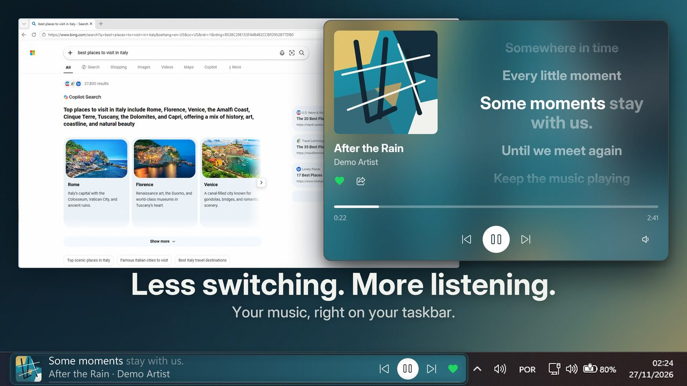
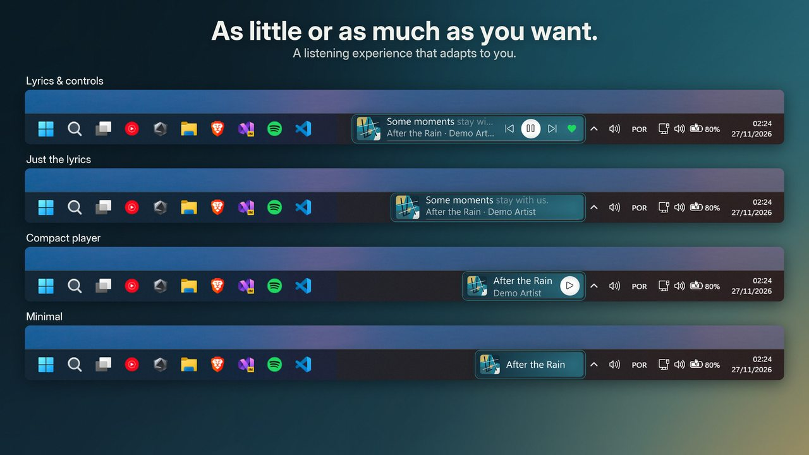
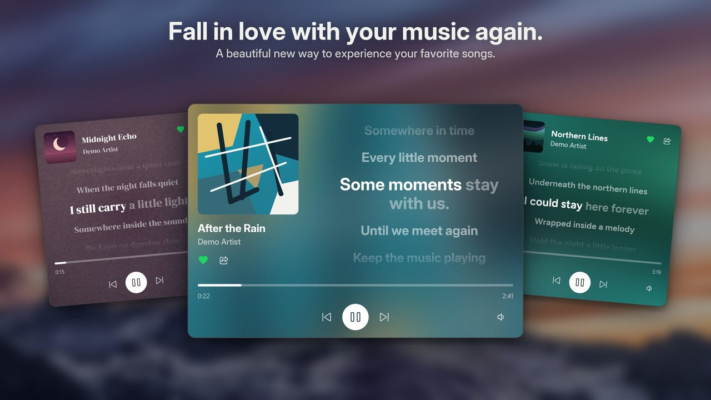
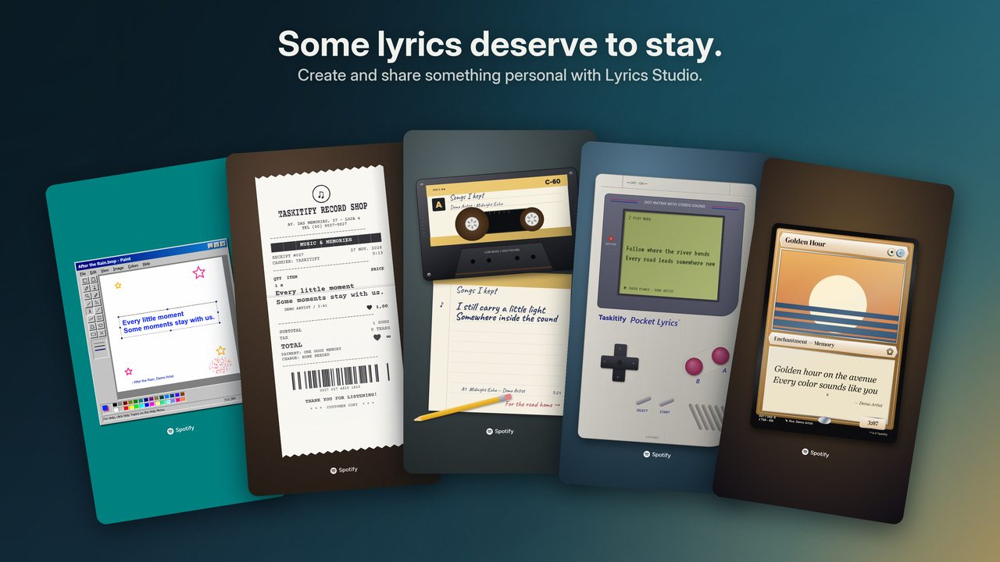
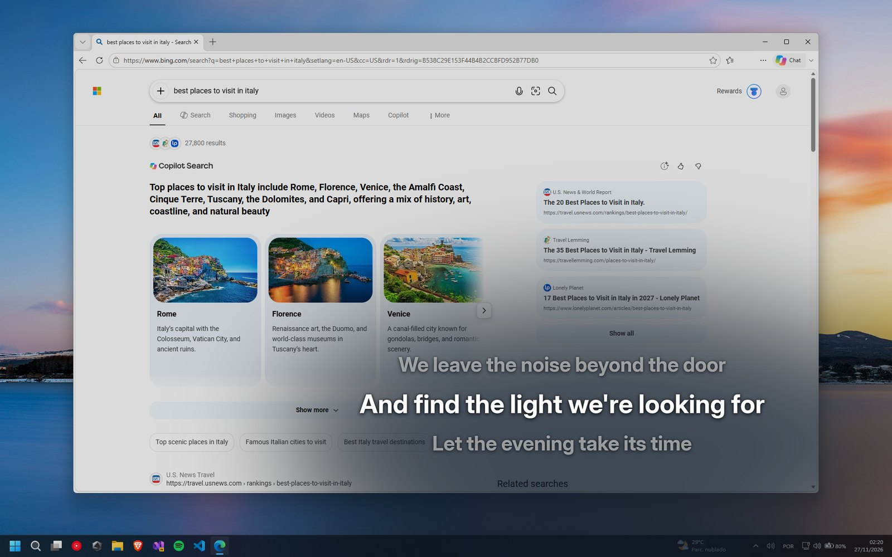
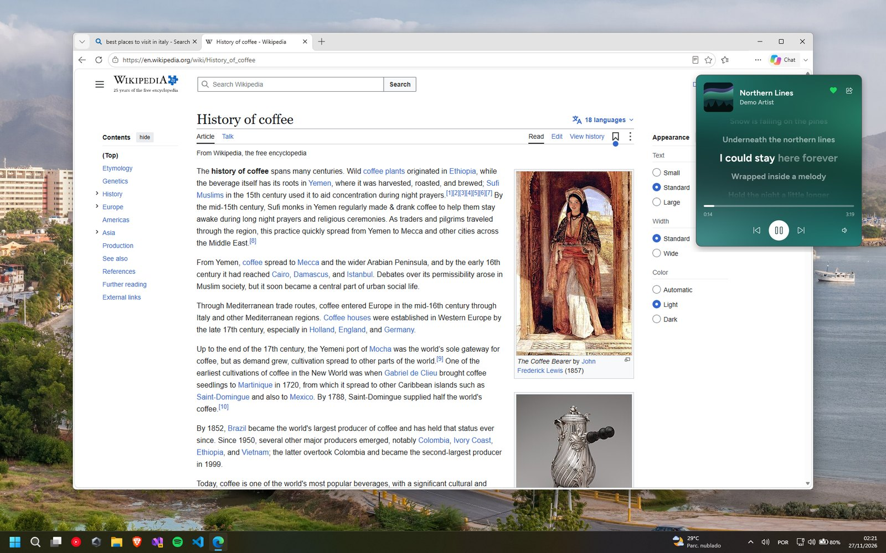

<p align="center">
  
</p>

<h1 align="center">Taskitify</h1>

<p align="center"><b>English</b> · <a href="README.pt-BR.md">Português</a></p>

<p align="center">
  <b>Synced Spotify lyrics on the Windows 11 taskbar, right where the weather widget sits.</b><br />
  Line by line, colored by the album art, with a mini player one click away.
</p>

<p align="center">
  <a href="https://apps.microsoft.com/detail/9nc2227dj01d"><b>Get it from Microsoft Store</b></a> ·
  <a href="https://github.com/CarlosVinniFernandes/Taskitify/releases/latest">Portable download</a> ·
  <a href="https://taskitify.vercel.app/">Website</a> ·
  <a href="#how-to-use">How to use</a>
</p>

<p align="center">
  
</p>

---

## What it is

Taskitify shows the line being sung in the song playing on Spotify **right on the taskbar**, in the space used by the Windows 11 weather widget.

- **Playing:** the lyric replaces the weather and follows the song line by line.
- **Paused, stopped or Spotify closed:** the weather comes back instantly, or Taskitify shrinks to a compact player if you prefer.
- **Click the lyric:** a mini player opens with the album art, controls, progress and the scrolling lyrics.

No Spicetify, Spotify login or Premium is needed for the default LRCLIB source. Taskitify reads what is playing through Windows' own media session. An optional, experimental Spotify connection can also fetch lyrics from Spotify itself and enables the like button.

## Features

| | |
|---|---|
| 🎤 **Synced lyrics** | The current line on the taskbar, in one or two lines, word by word when the lyrics allow it. Keeps up with pauses, skips and seeks. |
| 🎨 **Album colors** | A gradient taken from the album art, fading to the new colors on every song. |
| 🎛️ **Taskbar player** | Previous, play/pause, next, shuffle, repeat, volume, like and progress. You choose which ones appear. |
| 🪟 **Mini player** | Album art, controls and the full scrolling lyrics. Templates, backgrounds, highlight and motion styles, previewed live with the song you are playing. Save your own looks. |
| ✨ **Minimal Mode** | Just the lyrics, floating over Windows, your desktop or a borderless game. Clicks go through to whatever is underneath; **Ctrl + Alt + click** to move or resize. Prefer more? *Not that minimal* floats the whole mini player instead. |
| 🖼️ **Lyrics Studio** *(Beta)* | Turn a few lines into a shareable image, in more than 40 styles: Polaroid, cassette, boarding pass, handheld console, receipt and more. |
| 🧭 **Welcome tour** | A short guided setup on first launch, with the real players. |
| 🖥️ **Made for Windows 11** | Hides with the taskbar in full screen, never steals focus, stays out of Alt+Tab, handles DPI scaling and dark mode. |
| 🌍 **6 languages** | English, Português, Español, Français, Deutsch and Italiano. Settings → General → Language. |
| 🪶 **Lightweight** | About 65 MB of private memory and well under 1% of the CPU while playing; idle when paused. Never runs as administrator. |

<p align="center">
  
</p>
<p align="center"><sub>As little or as much as you want: four of the taskbar layouts.</sub></p>

<p align="center">
  
</p>
<p align="center"><sub>Mini player looks, all built in.</sub></p>

<p align="center">
  
</p>
<p align="center"><sub>Lyrics Studio (Beta). The songs and lyrics in these images are original demo content.</sub></p>

## Minimal Mode and the floating player

**Minimal Mode** keeps only the lyrics: the line being sung and its neighbours, floating over your desktop, your browser or a game in borderless full screen.

- Clicks go through to whatever is underneath. **Ctrl + Alt + click** the lyrics to move, resize or use them.
- **Ctrl + Alt + L** turns it on and off from anywhere, games included (you can choose other keys).
- It can come up by itself while chosen apps are in front, like a game, and go away when you leave them.
- Background, title, controls, text size and the number of verses are up to you. The taskbar player rests while it is on, unless you keep both.

<p align="center">
  
</p>

**Not that minimal** is for those who want more: the whole mini player, floating wherever you leave it, with all of its looks. The same shortcut and apps switch it on and off, and it can let clicks through too.

<p align="center">
  
</p>
<p align="center"><sub>Settings → Minimal Mode and Settings → Not that minimal. Both are off until you turn them on.</sub></p>

## Installation

**Microsoft Store (recommended):** [get Taskitify](https://apps.microsoft.com/detail/9nc2227dj01d). It updates automatically.

**Portable:**

1. Download `Taskitify-win-x64.zip` from [**Releases**](https://github.com/CarlosVinniFernandes/Taskitify/releases/latest).
2. Extract `Taskitify.exe` to a permanent folder, for example `Documents\Taskitify`.
3. Open `Taskitify.exe` and play a song on Spotify.

> **"Windows protected your PC"?** The portable executable is not signed with a paid certificate, so SmartScreen warns the first time. Click **More info**, then **Run anyway**. The code is open: review it here or [build it yourself](#building).

**Requirements:** 64-bit Windows 11 (or Windows 10 version 2004 or later) and **Spotify Desktop**. No .NET installation needed.

## Linux

On Ubuntu and other GNOME desktops, Taskitify shows the lyric line in the **top bar, next to the clock** (or in a floating bar), following Spotify Desktop through MPRIS. Install the `.deb` and see [**docs/LINUX.md**](docs/LINUX.md).

## How to use

| Action | What happens |
|---|---|
| First launch | A short tour sets up the taskbar, what happens when paused and the mini player. It also explains the two lyric sources (LRCLIB only, or Spotify + LRCLIB). |
| Play a song on Spotify | The lyric replaces the weather widget |
| Click the lyric | Opens or closes the mini player |
| `Esc` or click outside | Closes the mini player |
| Click a line in the mini player | Jumps the song to that line |
| Mouse wheel over the mini player's lyrics | Scrolls freely; **Sync with the song** goes back to the current line |
| Mouse wheel on the volume button | Changes Spotify's volume (click to mute) |
| Right-click the lyric | Lyric card, mini player mode, fetch lyrics again, calibrate position, settings, exit |
| Notification area icon | Mini player, Minimal Mode, lyric card, settings, tour, exit |
| **Ctrl + Alt + click** on Minimal Mode lyrics | Switches between letting clicks through and moving or resizing them |

To start with Windows: **Settings → General → Start with Windows**.

## Customization

Every player has its own page in **Settings**: **Bar**, **Minimized bar** (while paused), **Mini player**, **Minimal Mode** and **Not that minimal**. Each page shows a live replica. On the bar pages, click an element to show it (**green**) or hide it (**dimmed**).

You can also choose:

- **Background:** the album-art gradient or the taskbar's own color.
- **Main text:** the lyric or the song title.
- **When paused:** hide (the weather comes back) or shrink to a compact player.
- **No synced lyrics:** show the song title or hide.
- **Lyric motion and highlight** for the current line, font, size and width.
- **Timing adjustment**, globally or just for the song playing, if the lyrics run early or late.
- **Position calibration**, in case Windows places the weather widget somewhere else.

## Community Soundtrack

Taskitify users around the world are building a [shared playlist](https://open.spotify.com/playlist/0CMy9wXwlq6FRRdrIvvcWD). Suggest a song on the [website](https://taskitify.vercel.app/community).

## Privacy

### Optional Spotify lyrics

In **Settings → Advanced → Spotify lyrics (experimental) → Connect Spotify**, sign in directly on Spotify in the Taskitify window. Use email login if an external sign-in option does not open. Keep playback in Spotify Desktop; the web window is only for this connection and can be closed after signing in. This requires Microsoft Edge WebView2 Runtime.

For uncached songs, Spotify is asked first. LRCLIB is only asked when Spotify has no synced lyrics for the song or cannot be reached, which also keeps LRCLIB requests to a minimum. Local `.lrc` files still take precedence, and cached lyrics are reused. Use **Fetch lyrics again** → **Fetch lyrics from Spotify** or **from LRCLIB** to look a cached song up again in the source you pick (when the other version is better timed, for example). What that source finds becomes the saved lyrics; if it has none, the saved ones stay. Plain lyrics are used only if neither source returns synced lyrics, Spotify's first.

The hidden Spotify web window only opens to get an access token (about once an hour) and for the first search after Taskitify starts; it closes 30 seconds later. Song changes look lyrics up directly with Spotify, in about a second.

This uses Spotify's unofficial web-player lyrics service. Login does not guarantee access: Spotify can refuse lyrics, require renewed login, or change its service. The connection status distinguishes a captured session from a successful lyrics response. LRCLIB remains available when Spotify fails. Automated tests use simulated Spotify responses; account-specific access must be checked after signing in.

### Data

- No Taskitify account or telemetry. Spotify login is optional.
- LRCLIB receives the song title, artist, album and duration. When connected, Spotify also receives searches, lyrics requests and the likes you make; its web player makes its own network requests.
- Spotify login uses a separate WebView2 profile in `%LocalAppData%\Taskitify\spotify-web-session`; it does not read the Spotify Desktop or browser profiles. Access tokens stay in memory and are not written to settings or logs. **Disconnect** disables this source and clears the WebView2 browsing data. Lyrics may remain in the normal lyrics cache, which can be cleared separately.
- Settings and the lyrics cache stay on your computer: `%AppData%\Taskitify` and `%LocalAppData%\Taskitify`.

## FAQ

**The lyrics did not show up.** Some songs are not on LRCLIB; in that case the taskbar shows the song title. When LRCLIB is under heavy load, lyrics may take a few seconds to arrive. Right-click the lyric → **Fetch lyrics again** and pick a source to force a new lookup. You can also drop your own `.lrc` files in the lyrics folder (Settings → Advanced → **Open lyrics folder**), named `Artist - Title.lrc` or with `[ar:]`/`[ti:]` tags; they are used before LRCLIB.

**The lyrics are early or late.** Settings → Lyrics → **Timing adjustment**, for every song or just the one playing.

**The widget showed up in the wrong place.** Right-click → **Calibrate position**, drag it to move it, and drag its sides or use the mouse wheel to adjust the width.

**Does it work with Spotify in the browser?** No. Only Spotify Desktop (on purpose, so it is never confused with videos or other tabs).

**Can I like a song from Taskitify?** Yes, once Spotify is connected: the heart button adds the song to your Liked Songs.

## Building

Requires the [.NET 8 SDK](https://dotnet.microsoft.com/download/dotnet/8.0).

```powershell
dotnet build                                   # build
dotnet test tests/Taskitify.Tests              # 247 tests (lyrics, sync, colors, layout, languages)
dotnet run --project src/Taskitify             # run

# Single executable that needs no .NET installed
dotnet publish src/Taskitify -c Release -r win-x64 --self-contained true `
  -p:PublishSingleFile=true -p:IncludeNativeLibrariesForSelfExtract=true -p:DebugType=None -o publish
```

Self-contained publishes only ship what Taskitify uses: the Windows SDK projection is trimmed and unused framework assemblies (WinForms, VisualBasic, System.Data...) are left out, while every shipped assembly stays the original precompiled file. The Microsoft Store package is about 52 MB (119 MB installed). See [packaging/README.md](packaging/README.md) for the MSIX build.

To build the portable zip, compress `publish\Taskitify.exe` together with `dist\LEIA-ME.txt`. Architecture, technical decisions and known limitations are documented (in Portuguese) in [**docs/COMO-FUNCIONA.md**](docs/COMO-FUNCIONA.md).

## Feedback

Found a bug or have an idea? [Open an issue](https://github.com/CarlosVinniFernandes/Taskitify/issues). With **Settings → Advanced → Debug mode** on, **Diagnostics** in the notification area icon shows a log you can attach. Spotify access tokens are never written to it.

## Credits

- Lyrics: [LRCLIB](https://lrclib.net), the free community lyrics database, and, with the optional Spotify connection, Spotify's lyrics partners, usually [Musixmatch](https://www.musixmatch.com). The player and Lyrics Studio show "Lyrics provided by …" whenever lyrics come from Spotify.
- Fonts in Lyrics Studio and the players: Inter Display, Figtree, DM Serif Display, Caveat, Courier Prime, Pixelify Sans and VT323, all under the [SIL Open Font License](https://openfontlicense.org) (licenses in `src/Taskitify/Resources/Fonts`).
- Visual inspiration: [Spicetify Lyric Miniplayer](https://github.com/FO-SS/Spictify-Lyric-Miniplayer). Taskitify is a standalone native app, not a Spotify extension.
- Spotify is a trademark of Spotify AB. This project is not affiliated with Spotify or Microsoft.

## License

[MIT](LICENSE) © 2026 Carlos Fernandes
