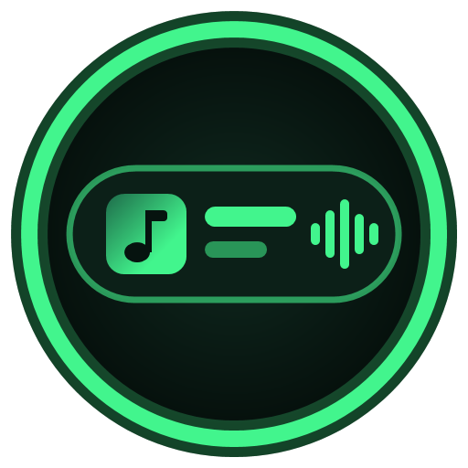
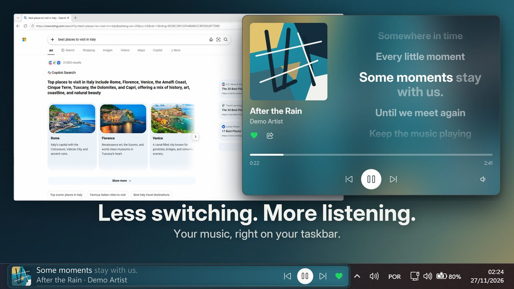
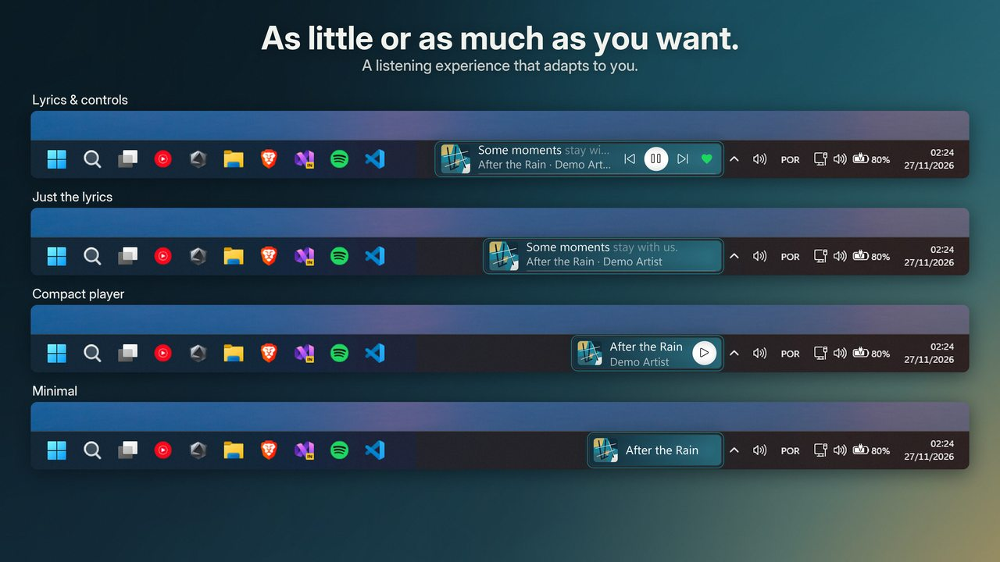
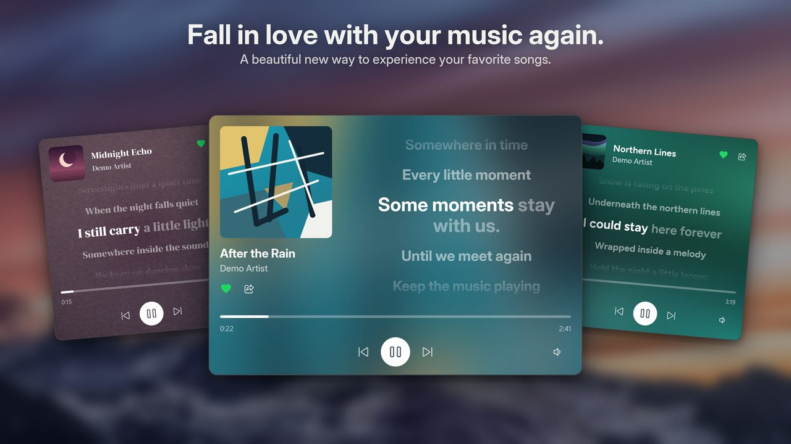
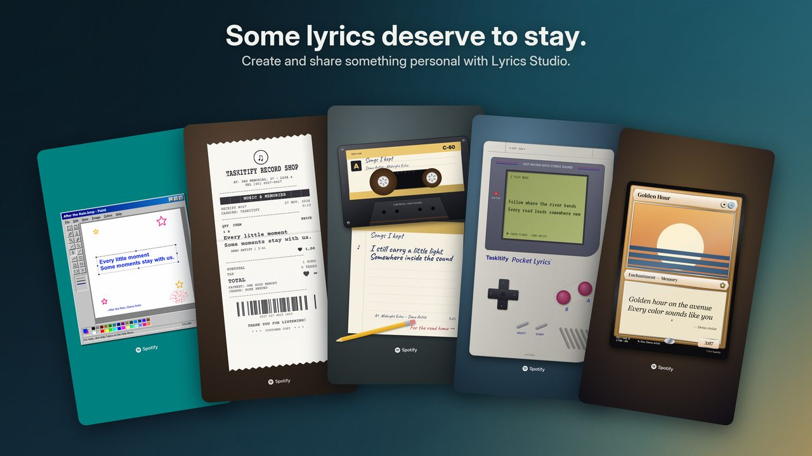

<p align="center">
  
</p>

<h1 align="center">Taskitify</h1>

<p align="center"><a href="README.md">English</a> · <b>Português</b></p>

<p align="center">
  <b>As letras do Spotify sincronizadas na barra de tarefas do Windows 11, no lugar do widget de clima.</b><br />
  Verso a verso, com as cores da capa do álbum e um mini player a um clique.
</p>

<p align="center">
  <a href="https://apps.microsoft.com/detail/9nc2227dj01d"><b>Baixar na Microsoft Store</b></a> ·
  <a href="https://github.com/CarlosVinniFernandes/Taskitify/releases/latest">Versão portátil</a> ·
  <a href="https://taskitify.vercel.app/pt-br">Site</a> ·
  <a href="#como-usar">Como usar</a>
</p>

<p align="center">
  
</p>

<p align="center"><sub>As imagens mostram o app em inglês, com músicas de demonstração. O Taskitify segue o idioma que você escolher.</sub></p>

---

## O que é

O Taskitify mostra o verso que está sendo cantado na música que toca no Spotify **direto na barra de tarefas**, no espaço do widget de clima do Windows 11.

- **Tocando:** a letra ocupa o lugar do clima e acompanha a música verso a verso.
- **Pausado, parado ou Spotify fechado:** o clima volta na hora; se preferir, o Taskitify vira um player compacto.
- **Clique na letra:** abre um mini player com capa, controles, progresso e a letra rolando.

A fonte padrão, o LRCLIB, não precisa de Spicetify, login no Spotify nem Premium. O Taskitify lê o que está tocando pela sessão de mídia do próprio Windows. Uma conexão opcional e experimental com o Spotify também busca letras no próprio Spotify e ativa o botão de curtir.

## Recursos

| | |
|---|---|
| 🎤 **Letras sincronizadas** | O verso atual na barra, em uma ou duas linhas, palavra por palavra quando a letra permite. Acompanha pausas, trocas de faixa e avanços. |
| 🎨 **Cores do álbum** | Um degradê tirado da capa, que muda suavemente a cada música. |
| 🎛️ **Player na barra** | Anterior, tocar/pausar, próxima, aleatório, repetir, volume, curtir e progresso. Você escolhe o que aparece. |
| 🪟 **Mini player** | Capa, controles e a letra completa rolando. Modelos, fundos, estilos de destaque e de movimento, com prévia ao vivo da música que está tocando. Salve seus próprios visuais. |
| ✨ **Minimal Mode** | Só a letra, flutuando sobre o Windows, a área de trabalho ou um jogo em tela cheia sem bordas. Os cliques passam para o que está embaixo; **Ctrl + Alt + clique** para mover ou redimensionar. Quer mais? O *Not that minimal* faz o mini player inteiro flutuar. |
| 🖼️ **Lyrics Studio** *(Beta)* | Transforme alguns versos em uma imagem para compartilhar, em mais de 40 estilos: Polaroid, fita cassete, cartão de embarque, console portátil, cupom fiscal e outros. |
| 🧭 **Tour de boas-vindas** | Uma configuração guiada e rápida na primeira vez, com os players de verdade. |
| 🖥️ **Feito para o Windows 11** | Some junto com a barra em tela cheia, nunca rouba o foco, fica fora do Alt+Tab e respeita a escala de DPI e o modo escuro. |
| 🌍 **6 idiomas** | English, Português, Español, Français, Deutsch e Italiano. Configurações → Geral → Idioma. |
| 🪶 **Leve** | Cerca de 65 MB de memória privada e bem menos de 1% da CPU tocando música; parado quando pausado. Nunca roda como administrador. |

<p align="center">
  
</p>
<p align="center"><sub>Do jeito que você quiser: quatro dos visuais da barra.</sub></p>

<p align="center">
  
</p>
<p align="center"><sub>Visuais do mini player, todos incluídos.</sub></p>

<p align="center">
  
</p>
<p align="center"><sub>Lyrics Studio (Beta). As músicas e letras destas imagens são conteúdo original de demonstração.</sub></p>

## Instalação

**Microsoft Store (recomendado):** [baixe o Taskitify](https://apps.microsoft.com/detail/9nc2227dj01d). As atualizações são automáticas.

**Versão portátil:**

1. Baixe `Taskitify-win-x64.zip` na página de [**Releases**](https://github.com/CarlosVinniFernandes/Taskitify/releases/latest).
2. Extraia o `Taskitify.exe` para uma pasta fixa, por exemplo `Documentos\Taskitify`.
3. Abra o `Taskitify.exe` e toque uma música no Spotify.

> **"O Windows protegeu o computador"?** O executável portátil não é assinado com um certificado pago, por isso o SmartScreen avisa na primeira vez. Clique em **Mais informações** e depois em **Executar assim mesmo**. O código é aberto: dá para revisar tudo aqui ou [compilar você mesmo](#compilar).

**Requisitos:** Windows 11 de 64 bits (ou Windows 10 versão 2004 ou mais recente) e o **Spotify Desktop**. Não é preciso instalar o .NET.

## Linux

No Ubuntu e em outros desktops GNOME, o Taskitify mostra o verso na **barra superior, ao lado do relógio** (ou em uma barra flutuante), acompanhando o Spotify Desktop pelo MPRIS. Instale o `.deb` e veja [**docs/LINUX.md**](docs/LINUX.md).

## Como usar

| Ação | O que acontece |
|---|---|
| Primeira abertura | Um tour rápido configura a barra, o que acontece na pausa e o mini player, e explica as duas fontes de letra (só LRCLIB, ou Spotify + LRCLIB). |
| Tocar uma música no Spotify | A letra ocupa o lugar do widget de clima |
| Clicar na letra | Abre ou fecha o mini player |
| `Esc` ou clicar fora | Fecha o mini player |
| Clicar em um verso no mini player | Leva a música até aquele verso |
| Roda do mouse na letra do mini player | Rola a letra livremente; **Sincronizar com a música** volta para o verso atual |
| Roda do mouse no botão de volume | Muda o volume do Spotify (clique para silenciar) |
| Botão direito na letra | Cartão de letra, modo do mini player, buscar a letra de novo, calibrar a posição, configurações, sair |
| Ícone na área de notificação | Mini player, Minimal Mode, cartão de letra, configurações, tour, sair |
| **Ctrl + Alt + clique** na letra do Minimal Mode | Alterna entre deixar os cliques passarem e mover ou redimensionar |

Para iniciar com o Windows: **Configurações → Geral → Iniciar com o Windows**.

## Personalização

Cada player tem sua página em **Configurações**: **Barra**, **Barra minimizada** (na pausa), **Mini player**, **Minimal Mode** e **Not that minimal**. Cada página mostra uma réplica ao vivo. Nas páginas da barra, clique em um elemento para mostrar (**verde**) ou esconder (**apagado**).

Também dá para escolher:

- **Fundo:** o degradê da capa ou a mesma cor da barra de tarefas.
- **Texto principal:** a letra ou o nome da música.
- **Na pausa:** esconder (o clima volta) ou virar um player compacto.
- **Sem letra sincronizada:** mostrar o nome da música ou esconder.
- **Movimento e destaque** do verso atual, fonte, tamanho e largura.
- **Ajuste de tempo**, para todas as músicas ou só a que está tocando, se a letra estiver adiantada ou atrasada.
- **Calibração da posição**, caso o Windows coloque o widget de clima em outro lugar.

## Trilha da Comunidade

Pessoas que usam o Taskitify no mundo todo estão montando uma [playlist em conjunto](https://open.spotify.com/playlist/0CMy9wXwlq6FRRdrIvvcWD). Sugira uma música no [site](https://taskitify.vercel.app/pt-br/community).

## Privacidade

### Letras opcionais do Spotify

Em **Configurações → Avançado → Letras do Spotify (experimental) → Conectar Spotify**, entre diretamente no Spotify pela janela do Taskitify. Use o login por e-mail se uma opção externa não abrir. Continue reproduzindo no Spotify Desktop; a janela web serve para a conexão e pode ser fechada após entrar. É necessário o Microsoft Edge WebView2 Runtime.

Para músicas sem cache, o Spotify é consultado primeiro. O LRCLIB só é consultado quando o Spotify não tem a letra sincronizada da música ou não responde, o que também reduz as requisições ao LRCLIB. Arquivos `.lrc` locais continuam tendo prioridade, e letras em cache são reutilizadas. Use **Buscar letra de novo** → **Buscar letra no Spotify** ou **no LRCLIB** para buscar de novo uma música já salva, na fonte que você escolher (por exemplo, quando a outra versão está com o tempo melhor). O que essa fonte achar passa a ser a letra salva; se ela não tiver a letra, a salva continua. Letras sem tempos só são usadas quando nenhuma fonte retorna letras sincronizadas, e a do Spotify vem primeiro.

A janela escondida do Spotify só abre para obter o token de acesso (cerca de uma vez por hora) e na primeira busca depois de iniciar o Taskitify; ela fecha 30 segundos depois. Nas trocas de música, a letra é buscada direto no Spotify, em cerca de um segundo.

A integração usa o serviço não oficial do player web do Spotify. Fazer login não garante acesso: o Spotify pode recusar letras, pedir novo login ou mudar o serviço. O status diferencia uma sessão conectada de uma letra recebida com sucesso. O LRCLIB continua disponível quando o Spotify falha. Os testes automatizados usam respostas simuladas; o acesso da sua conta precisa ser verificado após entrar.

### Dados

- Sem conta do Taskitify e sem telemetria. Login do Spotify é opcional.
- O LRCLIB recebe o nome da música, artista, álbum e duração. Quando conectado, o Spotify também recebe buscas, pedidos de letras e as músicas que você curtir; o player web faz suas próprias requisições.
- O login do Spotify usa um perfil WebView2 separado em `%LocalAppData%\Taskitify\spotify-web-session`, sem ler os perfis do Spotify Desktop ou do navegador. Tokens ficam na memória, fora das configurações e logs. **Desconectar** desativa a fonte e limpa os dados desse navegador. Letras já salvas permanecem no cache normal, que pode ser limpo separadamente.
- Configurações e cache de letras ficam só no seu computador: `%AppData%\Taskitify` e `%LocalAppData%\Taskitify`.

## Perguntas frequentes

**A letra não apareceu.** Algumas músicas não estão no LRCLIB; nesse caso a barra mostra o nome da música. Quando o LRCLIB está sobrecarregado, a letra pode levar alguns segundos para chegar. Clique com o botão direito na letra → **Buscar letra de novo** e escolha a fonte para forçar uma nova busca. Você também pode colocar seus próprios arquivos `.lrc` na pasta de letras (Configurações → Avançado → **Abrir pasta de letras**), com o nome `Artista - Música.lrc` ou com as tags `[ar:]`/`[ti:]`; eles são usados antes do LRCLIB.

**A letra está adiantada ou atrasada.** Configurações → Letras → **Ajuste de tempo**, para todas as músicas ou só a que está tocando.

**O widget apareceu no lugar errado.** Clique com o botão direito → **Calibrar posição**, arraste para mover e ajuste a largura arrastando as laterais ou com a roda do mouse.

**Funciona com o Spotify no navegador?** Não. Só com o Spotify Desktop (de propósito, para não confundir com vídeos e outras abas).

**Dá para curtir a música pelo Taskitify?** Sim, com o Spotify conectado: o botão de coração adiciona a música às suas Músicas Curtidas.

## Compilar

Requer o [SDK do .NET 8](https://dotnet.microsoft.com/download/dotnet/8.0).

```powershell
dotnet build                                   # compilar
dotnet test tests/Taskitify.Tests              # 247 testes (letras, sincronia, cores, layout, idiomas)
dotnet run --project src/Taskitify             # executar

# Executável único, sem precisar do .NET instalado
dotnet publish src/Taskitify -c Release -r win-x64 --self-contained true `
  -p:PublishSingleFile=true -p:IncludeNativeLibrariesForSelfExtract=true -p:DebugType=None -o publish
```

As publicações self-contained levam só o que o Taskitify usa: a projeção do Windows SDK é aparada e os assemblies do framework sem uso (WinForms, VisualBasic, System.Data...) ficam de fora, enquanto todo assembly incluído continua sendo o arquivo original pré-compilado. O pacote da Microsoft Store tem cerca de 52 MB (119 MB instalado). O empacotamento MSIX está em [packaging/README.md](packaging/README.md).

Para montar o zip portátil, compacte o `publish\Taskitify.exe` junto com o `dist\LEIA-ME.txt`. A arquitetura, as decisões técnicas e as limitações conhecidas estão em [**docs/COMO-FUNCIONA.md**](docs/COMO-FUNCIONA.md).

## Créditos

- Letras: [LRCLIB](https://lrclib.net) e, opcionalmente, o Spotify.
- Inspiração visual: [Spicetify Lyric Miniplayer](https://github.com/FO-SS/Spictify-Lyric-Miniplayer). O Taskitify é um app nativo independente, não uma extensão do Spotify.
- Spotify é marca registrada da Spotify AB. Este projeto não tem vínculo com o Spotify nem com a Microsoft.

## Licença

[MIT](LICENSE) © 2026 Carlos Fernandes
